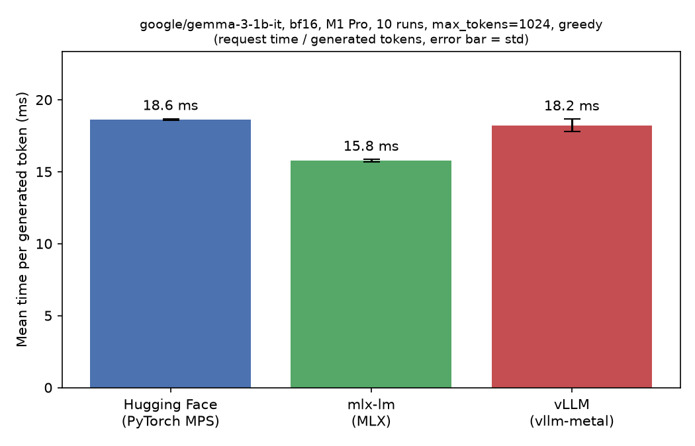
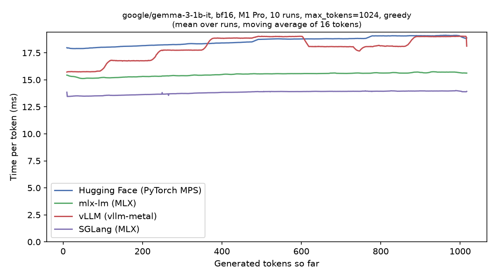

# llm-M1Pro-inference-time-test

How fast does the same model, **Gemma 3 1B (`google/gemma-3-1b-it`, bf16)**, run on a
MacBook Pro M1 Pro under four frameworks? Everything runs natively (Docker has no
Metal GPU access on macOS).

| | Framework | Compute backend | Port |
|---|---|---|---|
| A | Hugging Face transformers (`transformers serve`) | PyTorch MPS | 8001 |
| B | mlx-lm (`mlx_lm.server`) | MLX (Metal) | 8002 |
| C | vllm-metal (`vllm serve`) | vLLM engine + MLX (Metal) | 8003 |
| D | SGLang (`sglang.launch_server`) | SGLang engine + MLX (Metal) | 8004 |

A vs B compares PyTorch MPS with MLX. C and D each put a serving engine (scheduler,
paged KV cache) on top of MLX, so B vs C vs D shows what each engine adds, and C vs D
compares the two engines.

`run_experiment.py` starts A, sends it 3 warm-up and 10 timed requests, stops it, then
does the same for B, C and D. It produces two plots:

- `results/time_per_token.png`: bar chart of the mean time per generated token
  (request time / generated tokens) for each framework.
- `results/latency_vs_tokens.png`: time per token against the number of tokens generated so
  far, one line per framework. Each step attends to a longer context, so the lines are
  expected to rise slowly; the gap between them shows which framework is faster.

## Results

Measured on a MacBook Pro M1 Pro on 2026-11-18 (data in `results/`). Settings: one request
at a time, greedy decoding (`temperature=0`), a long-story prompt, `max_tokens=1024`,
3 warm-up requests, then 10 timed runs per framework. Every one of the 30 timed requests
generated exactly 1,024 tokens, so all three are compared on identical output lengths.
SGLang (D) is not in this run.



| Framework | Time per token (median) | Range over 10 runs | Decode speed | Time to first token | Whole request |
|---|---|---|---|---|---|
| **mlx-lm** (MLX) | **15.8 ms** | 15.6–15.9 ms | **63.6 tokens/s** | 79 ms | 16.2 s |
| vLLM (vllm-metal, MLX) | 18.1 ms | 18.0–19.4 ms | 55.4 tokens/s | **67 ms** | 18.5 s |
| Hugging Face (PyTorch MPS) | 18.6 ms | 18.6–18.7 ms | 54.0 tokens/s | 99 ms | 19.1 s |

Decode speed = (tokens − 1) / (request time − time to first token), so it excludes the
prompt processing.



| Framework | Tokens 2–64 | Tokens 768–1024 | Change |
|---|---|---|---|
| mlx-lm | 15.6 ms | 15.8 ms | +2% |
| Hugging Face | 17.9 ms | 18.8 ms | +5% |
| vLLM | 15.8 ms | 18.9 ms | +19% (in steps) |

### Discussion

**mlx-lm is the fastest by a clear margin.** It generates tokens about 15% faster than
both other frameworks. Each framework's 10 runs stay within about 0.1 ms of each other
(apart from one slower vLLM run), so the 2.8 ms gap is a real difference, not noise.

**PyTorch MPS vs MLX (A vs B).** Same weights and precision, different compute library:
MLX is 15% faster per token and reaches the first token 20 ms sooner. Hugging Face is
still close to vLLM (3% slower), so PyTorch's Mac GPU backend is competitive for
single-request generation; it just isn't as efficient as MLX.

**What the vLLM engine adds on top of MLX (B vs C).** vllm-metal runs mlx-lm's own model
code, so this comparison isolates the vLLM engine (scheduler, paged KV cache, its own
attention kernel):

- It has the fastest time to first token (67 ms vs 79 ms for mlx-lm).
- For the first ~100 tokens it generates exactly as fast as mlx-lm (15.8 ms per token).
- After that it slows down in steps, to about 19 ms per token. The steps fall at the
  same token positions in all 10 runs, so they come from the growing context, not from
  heat or background activity. The most likely cause is the engine's paged KV cache and
  attention path behaving differently as the context grows; the dip around tokens
  640–830 may be Gemma 3's sliding-window layers releasing old cache blocks. Both are
  hypotheses, not verified.

vLLM is designed to serve many requests at once (continuous batching). With one request
at a time, its scheduling machinery is pure overhead, so this run is its least favourable
case. Testing 4 and 16 simultaneous requests would show whether it pulls ahead there.

**Longer context costs little.** Each new token attends to everything generated before
it, so time per token should rise as the output grows. It does, but only slightly: Gemma 3
uses a 512-token sliding window on most of its layers, which keeps attention cheap. mlx-lm
stays almost flat (+2% over 1,000 tokens), Hugging Face rises steadily (+5%), and only
vLLM rises noticeably (+19%), for the engine-related reasons above.

**How close to the hardware limit.** Generating a token means reading all ~2 GB of bf16
weights once, and the M1 Pro's memory bandwidth is about 200 GB/s, which caps a 1B model
at roughly 100 tokens/s. mlx-lm reaches about 64% of that ceiling (63.6 tokens/s × 2 GB
≈ 127 GB/s), Hugging Face and vLLM about 55%. So even this small model is largely limited
by memory bandwidth, and the frameworks differ in how much overhead they add on top.

### Limits of this run

- One model size, one prompt and one request at a time. Bigger models (more
  bandwidth-bound) or many simultaneous users (where vLLM's batching helps) may rank the
  frameworks differently.
- The frameworks ran in a fixed order (Hugging Face, mlx-lm, vLLM) rather than
  alternating. Heat does not explain vLLM's steps (they repeat at the same positions in
  every run), but alternating the order would rule it out completely.
- The bandwidth figures assume ~2 GB of weights read per token; they are estimates.

## Requirements

- Apple Silicon Mac, macOS 15 (Sequoia) or later (needed by vllm-metal)
- About 15 GB free disk (model weights + four Python environments + the SGLang source)
- [uv](https://docs.astral.sh/uv/): `curl -LsSf https://astral.sh/uv/install.sh | sh`
- A Hugging Face account

## Setup (one time)

**1. Clone and install the benchmark client**

```bash
git clone https://github.com/NynsenFaber/llm-M1Pro-inference-time-test.git
cd llm-M1Pro-inference-time-test
uv sync
```

**2. Get access to Gemma**

Gemma is a gated model. Open https://huggingface.co/google/gemma-3-1b-it, accept the
license, then create a read token at https://huggingface.co/settings/tokens and log in:

```bash
uv run hf auth login
uv run hf download google/gemma-3-1b-it
```

The weights go to `~/.cache/huggingface/hub`, which all four frameworks share.

**3. Install the transformers and mlx-lm servers**

Each has its own environment because their dependencies conflict.

```bash
uv sync --project servers/transformers
uv sync --project servers/mlx-lm
```

**4. Install vllm-metal**

The official installer creates its own environment in `~/.venv-vllm-metal`:

```bash
curl -fsSL https://raw.githubusercontent.com/vllm-project/vllm-metal/main/install.sh | bash
```

(Homebrew also works: `brew tap vllm-project/vllm-metal https://github.com/vllm-project/vllm-metal`
then `brew install vllm-project/vllm-metal/vllm-metal`. The start script finds either.)

**5. Install SGLang**

SGLang is a uv project like the transformers and mlx-lm servers (`servers/sglang/pyproject.toml`
and `uv.lock`), but it has no macOS package, so its [Apple Silicon guide](https://docs.sglang.io/docs/hardware-platforms/apple_metal)
installs it from source. This script downloads that source at a fixed commit into
`servers/sglang/src`, applies the guide's one setup step, then runs `uv sync`. It takes a
few minutes:

```bash
servers/sglang/install.sh
```

It needs macOS 14 or newer and git. It skips two optional native parts: SGLang's own Metal
kernels (they need the full Xcode app) and a Rust extension used only by some
image/video models. The server runs on SGLang's MLX backend (`SGLANG_USE_MLX=1`).

## Run the experiment

Plug in the charger, turn Low Power Mode off and close browsers and other GPU-heavy apps.
Make sure nothing else is using ports 8001-8004. Then:

```bash
uv run python run_experiment.py
```

It prints each request's time, a summary table, and saves in `results/`:

- `time_per_token.png` and `latency_vs_tokens.png`: the two plots above
- `results.csv`: one row per timed request (`framework, run, total_s, ttft_s, tokens, ms_per_token`)
- `token_times.csv`: elapsed time at every generated token of every request
  (`framework, run, token, elapsed_s`), the data behind the line plot
- `logs/<framework>.log`: server output, for when something fails

If a framework fails, the script says so, keeps going with the others and plots the ones
that worked. Useful options:

```bash
uv run python run_experiment.py --only mlx-lm vllm      # rerun a subset
uv run python run_experiment.py --runs 20 --max-tokens 2048   # longer outputs
uv run python run_experiment.py --smooth 32                    # smoother lines
uv run python run_experiment.py --temperature 0.7 --seed 42    # sampling, reproducible
```

All requests use `temperature=0`, the same prompt (a request for a long story, so each
answer is long enough to show the trend) and `max_tokens` 1024 by default. Times are per
generated token, so frameworks stay comparable even if they stop at slightly different
lengths.

**Reproducibility.** By default decoding is greedy (`temperature=0`): the model always
picks the most likely token, so there is nothing random and every run of the same prompt
gives the same text. With `--temperature > 0` the script also sends `--seed` (default 0)
with every request, so sampled outputs repeat too. The seed is not sent with greedy
decoding because mlx-lm turns off its batched generation path for seeded requests, which
would change what is measured. Timings still vary a little between runs (that is what
the error bars show); no seed can remove that.

Servers may stream several tokens in one chunk; the script then spreads that
chunk's time evenly over its tokens, using the token count from the response's `usage`.

## Run a server by hand

```bash
servers/transformers/serve.sh   # A, port 8001
servers/mlx-lm/serve.sh         # B, port 8002
servers/vllm-metal/serve.sh     # C, port 8003
servers/sglang/serve.sh         # D, port 8004
```

```bash
curl -s localhost:8002/v1/chat/completions -H 'Content-Type: application/json' \
  -d '{"model":"google/gemma-3-1b-it","messages":[{"role":"user","content":"write me a joke"}],"max_tokens":32,"temperature":0}'
```

## Troubleshooting

- **A server never becomes ready / 401 or "gated repo" in the log:** the license isn't
  accepted or `hf auth login` wasn't run. mlx-lm keeps its port open and answers 404
  when the model failed to load, so look in `results/logs/mlx-lm.log`.
- **mlx-lm or vllm-metal can't load the original repo:** use the MLX bf16 copy (same
  precision) for that run, e.g.
  `MODEL=mlx-community/gemma-3-1b-it-bf16 uv run python run_experiment.py --only mlx-lm`.
  Avoid 4-bit or QAT checkpoints: they would not be a fair comparison.
- **transformers fails with an op "not implemented for MPS":** CPU fallback is disabled
  on purpose so timings stay GPU-only. To see whether it runs at all, start it with
  `PYTORCH_ENABLE_MPS_FALLBACK=1`, and note it in the results.
- **"vllm not found":** install vllm-metal (step 4).
- **"SGLang not installed":** run `servers/sglang/install.sh` (step 5). SGLang's Apple
  Silicon support is new: if it fails on Gemma 3, the other three still run; skip it with
  `--only transformers mlx-lm vllm` and check `results/logs/sglang.log`.
